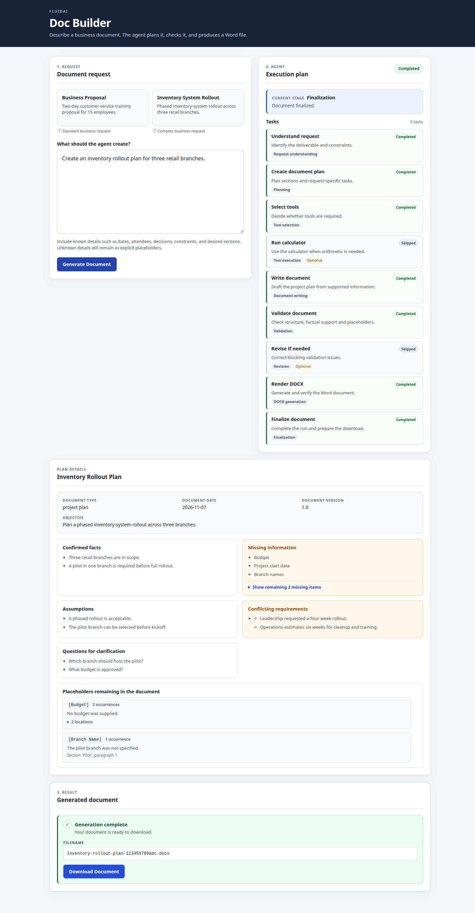
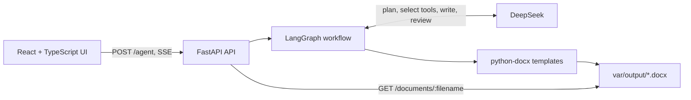

# FluidAI Doc Builder

FluidAI Doc Builder is a local proof-of-concept autonomous agent that turns a
business request into a structured Microsoft Word document. It combines a
React frontend, a FastAPI API, a LangGraph workflow and DeepSeek models with
deterministic validation and DOCX rendering.



## What it does

- Understands a document request and produces a validated execution plan.
- Optionally selects and runs a safe calculator tool when arithmetic is needed.
- Writes structured content while keeping assumptions and missing information
  explicit.
- Validates the result with deterministic checks and an optional LLM reviewer.
- Revises only for blocking factual or structural problems.
- Generates a verified `.docx` file from deterministic python-docx templates.
- Streams plan, progress, metadata, placeholder, completion and error events to
  the browser over one SSE connection.

## Supported document types

| Document type | Enum value | Typical purpose |
| --- | --- | --- |
| Business proposal | `business_proposal` | Propose a solution or course of action and seek approval. |
| Meeting minutes | `meeting_minutes` | Record meeting details, discussion, decisions and action items. |
| Project plan | `project_plan` | Describe execution, milestones, responsibilities and timelines. |
| Business report | `business_report` | Communicate findings, analysis, results and recommendations. |
| Technical design | `technical_design` | Describe architecture, components, interfaces and implementation. |
| SOP | `sop` | Document repeatable procedures and operational instructions. |
| Product specification | `product_specification` | Define requirements, behaviour, users and acceptance criteria. |
| Other | `other` | Fallback when no specialised type fits reliably. |

## Architecture



The browser sends one request to `POST /agent` and consumes the resulting SSE
stream. The backend translates LangGraph activity into safe plan and progress
events, then emits a final response and download details. See the
[backend guide](backend/README.md) for the full workflow and API contract.

## Requirements

- Python 3.12
- [uv](https://docs.astral.sh/uv/)
- Node.js 22.12 or newer and npm for the frontend
- A DeepSeek API key for document generation

The backend starts without a DeepSeek key, but planning, writing and review
require one. Health checks and downloads of existing files do not.

## Getting started

Run the backend and frontend in separate terminals from the repository root.

### 1. Backend

```bash
uv sync
cp .env.example .env
```

Set `DEEPSEEK_API_KEY` in `.env`, then start the API:

```bash
uv run uvicorn backend.app.main:app --reload
```

Check it is running:

```bash
curl http://127.0.0.1:8000/health
# {"status":"ok"}
```

### 2. Frontend

```bash
cd frontend
npm ci
npm run dev
```

Open <http://127.0.0.1:5173>. The Vite development server proxies `/agent`,
`/documents` and `/health` to `http://127.0.0.1:8000`, so no frontend
environment variables or CORS configuration are required.

## Configuration

Settings are loaded from the environment or a local `.env` file. See
[`.env.example`](.env.example) for the template.

| Variable | Default | Required for generation |
| --- | --- | --- |
| `DEEPSEEK_API_KEY` | unset | yes |
| `DEEPSEEK_MODEL` | `deepseek-flash` | no |
| `DEEPSEEK_BASE_URL` | `https://api.deepseek.com` | no |
| `DEEPSEEK_REASONING_EFFORT` | `low` | no |

Never commit `.env` or expose the API key through frontend variables.

## Using the app

Enter a request, or choose one of the example requests, and select **Generate
Document**. The UI shows the execution plan and task progress while the agent
works, then displays the completed filename and a download link.

You can also stream a request directly:

```bash
curl -N -X POST http://127.0.0.1:8000/agent \
  -H 'Content-Type: application/json' \
  -H 'Accept: text/event-stream' \
  -d '{"request": "Create a short business report for the Atlas project."}'
```

On success the stream ends with a single `token` event followed by `complete`.
The token carries the final user-facing response, not incremental model output.
See the [backend guide](backend/README.md#api-and-sse-contract) for the complete
event semantics and payloads.

### Generated files

Documents are written to `var/output/` by default. Filenames use a lowercase
descriptive slug (up to 48 characters), a hyphen and a unique 12-character
lowercase hexadecimal identifier, for example:

```text
quarterly-business-report-a1b2c3d4e5f6.docx
```

The document date defaults to the generation date and the version defaults to
`1.0` unless the plan supplies them.

## Testing and quality

Backend:

```bash
uv run pytest
uv run ruff check .
uv run ruff format --check .
```

The normal suite is offline and skips the opt-in live DeepSeek tests. Live
tests make paid provider calls and require both `DEEPSEEK_API_KEY` and
`RUN_LIVE_DEEPSEEK_TESTS=1`. See the [backend guide](backend/README.md#testing).

Frontend:

```bash
cd frontend
npm test
npm run build
```

`npm run build` runs the TypeScript check and creates a production bundle.
There is no separate frontend lint script.

## Project layout

```text
backend/app/       FastAPI application, agent graph and document rendering
backend/tests/     Offline tests and opt-in live DeepSeek tests
frontend/src/      React UI, SSE client, placeholder grouping and result text
frontend/tests/    Node test-runner tests
var/output/        Generated DOCX files (gitignored except .gitkeep)
assets/            Documentation images
```

## Documentation

- [Backend guide](backend/README.md) — architecture, LangGraph routing, API/SSE,
  validation, placeholders, DOCX generation and testing.
- [Frontend guide](frontend/README.md) — setup, UI workflow, Fetch-based SSE
  parsing, downloads and frontend tests.
- [Coding-agent instructions](AGENTS.md) — repository development rules.

## Scope and limitations

This is a local proof of concept. It has no authentication, database,
multi-user isolation, external research tool, deployment configuration or
container orchestration. Treat generated documents as drafts and review
factual content before use.
