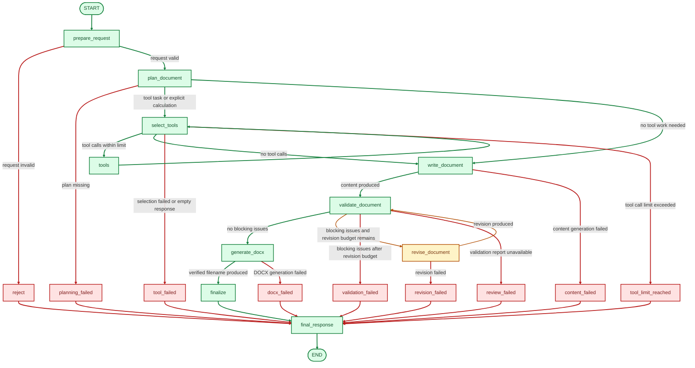

# Backend Guide

This is the backend reference for FluidAI Doc Builder. It covers the FastAPI
API, LangGraph workflow, model configuration, tool execution, validation,
placeholder handling, DOCX generation and tests.

The backend is a local proof of concept. It has no authentication, database or
external research capability.

## Stack and layout

The backend uses Python 3.12, FastAPI, Pydantic, pydantic-settings, LangGraph,
`langchain-deepseek` and python-docx. Development uses uv, Ruff, Pytest and
HTTPX.

```text
backend/app/
  main.py                 FastAPI app factory and health route
  config.py               pydantic-settings configuration
  api/
    agent.py              POST /agent SSE and GET /documents routes
    progress.py           graph event to task-progress mapping
  agent/
    graph.py              LangGraph workflow, routing and terminal nodes
    state.py              typed request-local graph state
    models.py             document plan, tasks, conflicts and placeholders
    planning.py           request understanding and plan generation
    tool_selection.py     conditional tool selection
    tools/calculator.py   safe calculator tool
    document_content.py   structured generated-content models
    document_writer.py    content generation and revision
    validation.py         deterministic checks, LLM review and severity policy
    placeholders.py       rendered-placeholder inventory
    docx_generator.py     DOCX file creation, verification and filename safety
    docx_templates.py     deterministic per-document-type renderers
  services/llm.py         DeepSeek model construction
backend/tests/            Offline tests and opt-in live tests
```

Start the service from the repository root with:

```bash
uv sync
cp .env.example .env   # set DEEPSEEK_API_KEY
uv run uvicorn backend.app.main:app --reload
```

## API and SSE contract

### `POST /agent`

Accepts a JSON body:

```json
{"request": "Create a short business report for the Atlas project."}
```

Returns `text/event-stream`. Each event uses the standard SSE form:

```text
event: progress
data: {"stage":"document_writing","task_ids":["write_document"],"status":"active","message":"Writing document..."}
```

The API emits a safe, curated stream. It does not expose model reasoning, raw
tool calls, raw tool results or internal messages.

### `GET /documents/{filename}`

Downloads a generated DOCX as an attachment. Only filenames matching

```text
^[a-z0-9][a-z0-9-]*-[0-9a-f]{12}\.docx$
```

are accepted. Missing files, invalid names, path traversal and symlink escapes
return `404`.

### `GET /health`

Returns:

```json
{"status":"ok"}
```

FastAPI also exposes its generated API documentation at `/docs` and
`/openapi.json` while the service is running.

## SSE event semantics

On a successful run the stream order is:

```text
plan → progress events → metadata → placeholders → token → complete
```

Not every stage necessarily produces a `progress` event. Request understanding
and planning are represented in the initial task statuses of the `plan` event.
Tool selection, tool execution and revision may be skipped.

| Event | Payload | When it is emitted |
| --- | --- | --- |
| `plan` | `document_type`, `title`, `objective`, `audience`, `document_date`, `document_version`, `provided_facts`, `tasks`, `conflicts`, `missing_information`, `assumptions`, `clarification_questions`, `placeholders` | Once, after planning succeeds. |
| `progress` | `stage`, `task_ids`, `status`, `message` | As graph stages start, complete, skip or fail. Progress statuses are `active`, `completed`, `skipped` or `failed`; plan tasks also use `pending`. |
| `metadata` | `document_date`, `document_version` | Only after a DOCX has been generated successfully. |
| `placeholders` | `placeholders`: list of `text`, `location`, `reason` | Only after a DOCX has been generated successfully. An empty list is possible. |
| `token` | `text` | One final user-facing response event. It is not incremental model output. |
| `complete` | `filename`, `url` | Once, after a verified DOCX exists. `url` is relative, for example `/documents/report-a1b2c3d4e5f6.docx`. |
| `error` | `message` | A safe terminal failure. No `token` or `complete` follows. |

The `token` text starts with `Document generated successfully: <filename>`.
When validation produced warnings or informational findings, it also includes a
sanitized `Validation notes:` summary with counts and issue codes. The frontend
keeps the validation data but hides that summary from the completed download
result.

A failed run may emit a final `progress` event with `status: "failed"`, then an
`error` event. It does not emit `metadata`, `placeholders`, `token` or
`complete`.

## LangGraph workflow

The graph is built explicitly in `backend/app/agent/graph.py`. Dependencies can
be injected for tests; real planners, selectors, writers, validators and DOCX
generators are constructed lazily.



Green shows the successful path, red shows terminal failures, and amber shows
the corrective revision loop.

Key limits and routing rules:

- Tools are selected only when the plan contains a `tool_execution` task or the
  request contains a narrow explicit arithmetic expression.
- `MAX_TOOL_ROUNDS = 3`.
- `MAX_REVISION_ATTEMPTS = 2`.
- Planner, writer and reviewer each make at most two model attempts.
- Only blocking validation issues trigger revision. Warning-only results proceed
  directly to DOCX generation.
- `review_unavailable` is a warning, not a terminal path. The `review_failed`
  terminal node remains for the unexpected case where no validation report is
  available at all.

## Planning and document models

`DocumentPlanner` classifies the request into exactly one of eight document
types and asks the model for a `DocumentPlan` using JSON-mode structured output.

The supported types are `business_proposal`, `meeting_minutes`,
`project_plan`, `business_report`, `technical_design`, `sop`,
`product_specification` and `other`.

A valid plan includes:

- document type, title and objective;
- optional audience, document date and document version;
- at least one section with heading, purpose, key points and placeholders;
- provided facts, assumptions, missing information and clarification questions;
- request-specific execution tasks;
- optional requirement conflicts.

Validation rules include unique task IDs, required task stages for document
writing, validation and DOCX generation, unique section headings after whitespace
and case normalization, and unique placeholder text within a section.

The planner extracts `document_date` and `document_version` only when the user
explicitly supplies them. Meeting dates and task dates are never reused as the
document date.

References: `agent/planning.py`, `agent/models.py`, `tests/test_planning.py`.

## Model configuration

Configuration comes from environment variables or a local `.env` file through
`pydantic-settings`.

| Variable | Default |
| --- | --- |
| `DEEPSEEK_API_KEY` | unset |
| `DEEPSEEK_MODEL` | `deepseek-flash` |
| `DEEPSEEK_BASE_URL` | `https://api.deepseek.com` |
| `DEEPSEEK_REASONING_EFFORT` | `low` |

`build_chat_model()` raises `MissingDeepSeekApiKeyError` when no key is
configured. It constructs `ReasoningPreservingChatDeepSeek`, a small
`ChatDeepSeek` subclass that restores `reasoning_content` on assistant messages
during tool loops. Thinking mode is enabled for the model.

Planning, writing and review use `with_structured_output(..., method="json_mode")`
rather than forced tool selection. Tool selection binds the available tools with
`tool_choice="auto"`.

References: `config.py`, `services/llm.py`, `tests/test_llm.py`.

## Tool selection and the calculator

The only available tool is `calculate`. It supports basic arithmetic with `+`,
`-`, `*`, `/`, parentheses and unary signs, evaluated through a restricted
Python AST. It does not use `eval` and has no shell or filesystem access.

Safety limits:

- maximum expression length: 200 characters;
- maximum AST nodes: 100;
- maximum absolute numeric literal: `10**12`;
- maximum absolute result: `10**15`.

Division by zero, non-finite values, unsupported syntax and overly large values
return controlled calculation errors. Invalid tool arguments and tool failures
are returned to the model as tool messages so it can recover or finish safely.

References: `agent/tool_selection.py`, `agent/tools/calculator.py`,
`tests/test_calculator.py`, `tests/test_tool_selection.py`,
`tests/test_tool_graph.py`.

## Writing and revision

`DocumentWriter` requests `DocumentContent` from the model using JSON-mode
structured output. Pydantic validates the result, and the document type must
match the approved plan.

The writer is instructed not to invent facts, not to present planning
assumptions or conflict resolutions as confirmed facts, and to use justified
placeholders for unknown details. It may leave a section body empty when the
information is represented by structured fields or content is optional.

Section-order divergence from the plan is no longer a writer failure. The
validator records it as a warning and generation can continue.

`revise()` is only called when blocking issues remain and the revision budget is
available. It receives the blocking issues and suggestions, preserves supported
facts, and makes targeted edits. Warnings alone never trigger revision.

References: `agent/document_writer.py`, `agent/document_content.py`,
`tests/test_document_content.py`, `tests/test_revision.py`.

## Validation policy

Validation combines deterministic checks with an optional LLM reviewer.
`ValidationReport.passed` is true when there are no blocking issues. Each issue
has a severity of `blocking`, `warning` or `info`.

### Blocking checks

The current deterministic checks block for:

- generated content whose document type differs from the plan;
- a document with no section content and no populated structured fields;
- an SOP with no numbered procedure steps;
- a product specification with no requirements;
- a technical design with no components.

The reviewer can also block fabricated names, organisations, people, dates,
figures, commitments, decisions, policies, targets or technical specifications
presented as confirmed facts; unsupported factual claims; material
contradictions; wrong document type; and empty or structurally unusable output.

### Warnings and informational findings

Warnings do not stop DOCX generation. They include:

- section headings or order differing from the plan;
- individual empty sections when other content exists;
- incomplete meeting details, attendees, action items or decisions;
- missing project milestones or timeline sections;
- missing proposal deliverables, approach or timeline information;
- missing acceptance criteria or component interfaces;
- structured fields that are unusual for the document type;
- undeclared, ambiguous or empty placeholders;
- completeness and quality findings from the reviewer.

The reviewer prompt reserves `info` for optional omissions and non-essential
suggestions.

### Reviewer behavior and fallback

The reviewer runs only when deterministic checks have no blocking issues. Its
severity is normalized before merging:

- critical factual-integrity terms force a blocking severity;
- recognized completeness or quality terms downgrade a blocking issue to a
  warning;
- unrecognized blocking codes remain blocking.

If the reviewer is unavailable, returns invalid structured output, or cannot be
constructed because credentials are missing, validation falls back to the
deterministic result and adds a `review_unavailable` warning. If deterministic
checks pass, the document is still generated.

References: `agent/validation.py`, `tests/test_validation.py`,
`tests/test_validation_graph.py`,
`tests/test_live_deepseek_validation.py`.

## Placeholder handling

Plans declare placeholders per section with exact bracketed text and a reason.
Placeholder text must be unique within a section, but the same text may be
declared in multiple sections.

- Validation accepts a placeholder declared anywhere in the plan when it is
  reused in prose or structured fields.
- Undeclared bracketed placeholders are warnings, not generation failures.
- Empty brackets are warnings.
- A plan with missing information but no placeholders at all produces a warning.

The DOCX inventory scans body paragraphs, tables, nested tables, merged cells
and all header/footer variants. Each rendered occurrence records its location and
reason.

Reason resolution:

- use the matching section reason when available;
- use the single plan-wide reason when a placeholder is declared once and reused
  in another section;
- use a generic reason when multiple section reasons make the origin ambiguous;
- use a generic reason for undeclared placeholders;
- use deterministic reasons for known template placeholders such as `[Audience]`,
  `[Date]`, `[Version]`, `[Owner]`, `[Due date]` and `[Status]`.

The writer and revision prompts still express a preference for section-local
placeholder use. Cross-section reuse is accepted by validation; the prompts may
therefore not always take advantage of it.

References: `agent/placeholders.py`, `agent/validation.py`,
`tests/test_placeholders.py`.

## DOCX generation and templates

`DocxGenerator` renders validated content with python-docx, verifies the saved
file, and returns the filename, effective metadata and rendered placeholder
inventory.

### Output and filenames

The default output directory is `var/output/`. It is created automatically.
Filenames are:

```text
<lowercase descriptive slug, max 48 characters>-<12 lowercase hex characters>.docx
```

The slug is derived from the request, with leading command words such as
`create`, `draft` or `generate` removed. The identifier is generated randomly
for each document. The final path is checked to remain inside the output
directory.

Document date uses the plan value when present, otherwise the generation date.
Document version uses the plan value when present, otherwise `1.0`.

### Templates

| Document type | Renderer behavior |
| --- | --- |
| Business proposal | Cover details, document details table, page break, sections and a milestone table. |
| Meeting minutes | Meeting details, document details and sections, with an action-item table. |
| Project plan | Project details, sections and a milestone table. |
| Business report | Report details followed by sections. |
| Technical design | Document details, sections and a component/interfaces table. |
| SOP | Document details, sections and numbered procedure steps. |
| Product specification | Document details, sections and a requirements table. |
| Other | Generic title, document details and sections. |

All templates use consistent formatting: Calibri, 11pt body text, 24pt title,
14pt level-1 headings, 1-inch margins, a document header, footer and page number.

After saving, the generator reopens the document, checks the title and expected
headings, and scans placeholders. A partial file is removed if generation or
verification fails.

References: `agent/docx_generator.py`, `agent/docx_templates.py`,
`tests/test_docx_generation.py`, `tests/test_docx_templates.py`.

## Security boundaries

- No authentication or multi-user isolation; run only locally.
- The DeepSeek API key stays in the backend environment or local `.env`.
- There is no arbitrary shell execution or unrestricted filesystem access.
- Download filenames are pattern-checked and resolved paths must remain inside
  the configured output directory.
- The calculator uses a restricted AST, not `eval`.
- The agent does not perform external research or retrieve facts beyond the
  user request and deterministic tool results.
- The SSE stream exposes curated plan, progress, metadata, placeholder and
  terminal data only, never model reasoning or raw internal messages.

## Testing

Run the offline suite from the repository root:

```bash
uv run pytest
uv run ruff check .
uv run ruff format --check .
```

The normal suite does not require paid API calls. It uses fake models, fake
writers and deterministic DOCX output in temporary directories.

### Opt-in live DeepSeek tests

Live tests are skipped by default. They require a configured
`DEEPSEEK_API_KEY` and the shell variable `RUN_LIVE_DEEPSEEK_TESTS=1`, and they
make paid provider calls:

```bash
RUN_LIVE_DEEPSEEK_TESTS=1 uv run pytest \
  backend/tests/test_live_deepseek_documents.py \
  backend/tests/test_live_deepseek_tools.py \
  backend/tests/test_live_deepseek_validation.py \
  backend/tests/test_live_deepseek_e2e.py -v
```

Coverage includes live planning/writing/DOCX generation, the calculator tool
round trip, reviewer detection of a budget contradiction with revision, and the
complete API/SSE/download flow through the FastAPI app. The live tool test may
skip when the model does not choose the calculator.

References: `pyproject.toml`, `tests/conftest.py`, `tests/plan_factory.py`.

## Related documentation

- [Project overview and quick start](../README.md)
- [Frontend guide](../frontend/README.md)
- [Coding-agent instructions](../AGENTS.md)
- [Environment example](../.env.example)
